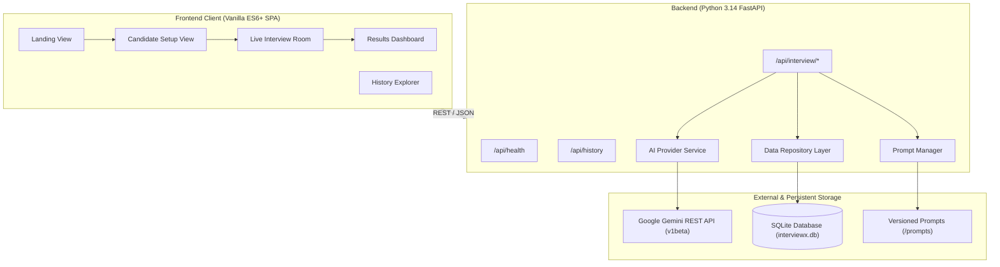

# InterviewX — Architecture & Technical Specification

> **Project:** InterviewX — AI-Powered Mock Interview Platform  
> **Course:** SCSE4041 Prompt Engineering Mini Project — Milestone 2  
> **Team:** Cognitive Crew  
> **Faculty Mentor:** Girjesh Ma'am  

---

## 1. Executive Summary

InterviewX is an intelligent, full-stack mock interview platform engineered to prepare students and job seekers for rigorous technical evaluations. Candidates configure their target role, experience tier (Fresher, Beginner, Intermediate, Experienced), specific technologies/skills, interview difficulty, and optional job description.

The application conducts a dynamic, multi-turn interview session: asking calibrated technical questions, evaluating submissions against a strict 4-dimension rubric (Technical Accuracy, Clarity, Relevance, Completeness), adjusting difficulty adaptively, and synthesizing an actionable final readiness report.

---

## 2. High-Level System Architecture

InterviewX is architected with clear boundaries between user presentation, backend orchestration, prompt templates, and persistence:



---

## 3. Technology Stack & Rationale

| Layer | Chosen Technology | Architectural Rationale |
|---|---|---|
| **Frontend** | Vanilla ES6+ HTML5/CSS3 | Zero node_modules or build dependencies, maximum reliability on Python-only host environments, sub-millisecond local rendering, responsive dark navy theme. |
| **Backend** | Python FastAPI (0.165.0) | High performance asynchronous REST API, native Pydantic validation, clear separation of concerns, auto-generated OpenAPI documentation. |
| **AI Integration** | Google Gemini API (REST v1beta) | Direct HTTP REST communication with `gemini-1.5-flash` or `gemini-2.0-flash`. Includes a clearly labeled Simulated Demo Mode when no key is set. |
| **Database** | SQLite3 | Zero-configuration, ACID compliant local persistence for sessions, exchanges, scores, and final summaries. |
| **Testing** | Pytest & pytest-asyncio | 15 automated test cases verifying normal, edge-case, and failure handling. |

---

## 4. SQLite Data Schema

### Table: `sessions`
Stores interview configuration and candidate profile metadata:
```sql
CREATE TABLE sessions (
    id TEXT PRIMARY KEY,
    candidate_name TEXT NOT NULL,
    target_role TEXT NOT NULL,
    experience_level TEXT NOT NULL,
    skills TEXT NOT NULL,
    difficulty TEXT NOT NULL,
    job_description TEXT,
    status TEXT NOT NULL DEFAULT 'in_progress',
    created_at TIMESTAMP DEFAULT CURRENT_TIMESTAMP,
    updated_at TIMESTAMP DEFAULT CURRENT_TIMESTAMP
);
```

### Table: `exchanges`
Stores each individual question asked, candidate submitted answer, 4-dimension rubric evaluation scores, feedback, and exemplar answer:
```sql
CREATE TABLE exchanges (
    id INTEGER PRIMARY KEY AUTOINCREMENT,
    session_id TEXT NOT NULL,
    question_number INTEGER NOT NULL,
    question_text TEXT NOT NULL,
    question_topic TEXT,
    expected_key_points TEXT,
    answer_text TEXT,
    overall_score REAL,
    score_technical REAL,
    score_clarity REAL,
    score_relevance REAL,
    score_completeness REAL,
    strengths_json TEXT,
    improvements_json TEXT,
    improved_answer TEXT,
    follow_up_question TEXT,
    created_at TIMESTAMP DEFAULT CURRENT_TIMESTAMP,
    FOREIGN KEY (session_id) REFERENCES sessions (id) ON DELETE CASCADE
);
```

### Table: `final_summaries`
Stores aggregated session statistics, executive readiness assessment, and revision roadmap:
```sql
CREATE TABLE final_summaries (
    id INTEGER PRIMARY KEY AUTOINCREMENT,
    session_id TEXT UNIQUE NOT NULL,
    overall_score REAL NOT NULL,
    average_score REAL NOT NULL,
    questions_answered INTEGER NOT NULL,
    summary_text TEXT NOT NULL,
    strengths_json TEXT NOT NULL,
    areas_for_improvement_json TEXT NOT NULL,
    topics_to_revise_json TEXT NOT NULL,
    recommendations_json TEXT NOT NULL,
    created_at TIMESTAMP DEFAULT CURRENT_TIMESTAMP,
    FOREIGN KEY (session_id) REFERENCES sessions (id) ON DELETE CASCADE
);
```

---

## 5. Security & Configuration Boundaries

1. **No Client-Side Secrets:** Gemini API keys are never passed to the browser or embedded in client assets. All AI requests are mediated by the backend.
2. **Environment Isolation:** Keys are loaded via backend `python-dotenv` from `.env`. The repository provides `.env.example` with placeholders only.
3. **Graceful Degradation:** When `GEMINI_API_KEY` is not supplied, the platform activates a labeled Simulated Demo Mode (`[SIMULATED - DEMO MODE]`), preventing crashes while strictly adhering to academic integrity standards.
4. **Input Sanitization & Server-Side Validation:** All candidate inputs (name, role, skills, answer length) are validated using Pydantic v2 schemas before being passed to prompt templates or stored.
