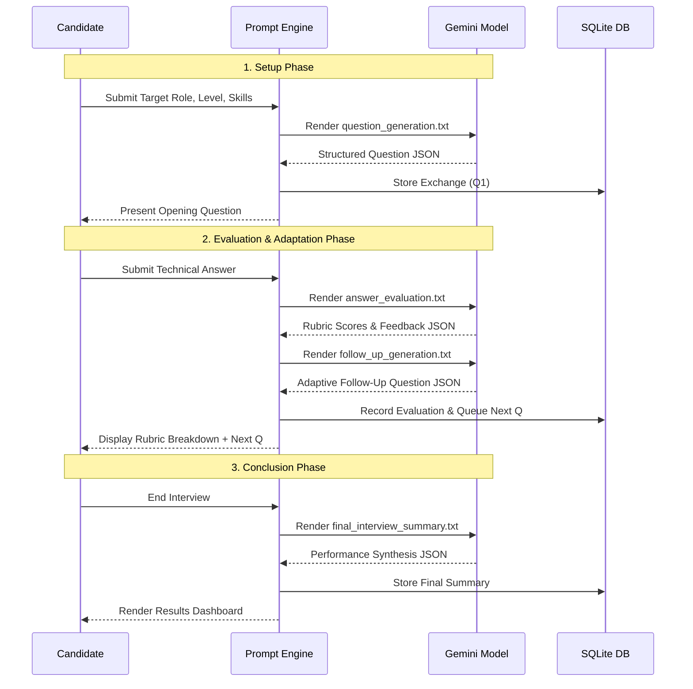

# InterviewX — Prompt Engineering Specification

> **Project:** InterviewX — AI-Powered Mock Interview Platform  
> **Course:** SCSE4041 Prompt Engineering Mini Project — Milestone 2  
> **Team:** Cognitive Crew  

---

## 1. Prompt Engineering Philosophy & Objectives

The prompt engineering architecture for InterviewX was developed to satisfy three non-negotiable principles:
1. **Modularity over Monoliths:** Rather than relying on a single conversational prompt that risks context drift and hallucination, the interview workflow is decomposed into four discrete, single-responsibility prompt tasks.
2. **Deterministic Output Schemas:** Every prompt requires the model to output strict JSON validated by Pydantic server-side.
3. **Rigorous Rubric Calibration:** High scores require demonstrated technical accuracy and depth appropriate for the candidate's declared experience level. Empty, deflecting, or irrelevant answers are explicitly penalized.

---

## 2. Prompt Architecture Workflow



---

## 3. Final Prompt Sheets

### Prompt Sheet 1: Question Generation
- **File:** `prompts/final/question_generation.txt`
- **Purpose:** Formulate role- and level-appropriate technical questions.
- **Input Variables:**
  - `{candidate_name}`: Candidate full name
  - `{target_role}`: Target job position
  - `{experience_level}`: Fresher, Beginner, Intermediate, Experienced
  - `{skills}`: Comma-separated technical skills
  - `{difficulty}`: Easy, Medium, Hard
  - `{job_description}`: Target posting context
  - `{previously_asked_questions}`: Deduplication context
  - `{question_number}`: Current ordinal
- **Required JSON Schema:**
  ```json
  {
    "question_number": 1,
    "question": "string",
    "topic": "string",
    "expected_key_points": ["string", "string"]
  }
  ```

---

### Prompt Sheet 2: Answer Evaluation
- **File:** `prompts/final/answer_evaluation.txt`
- **Purpose:** Rigorous rubric evaluation across 4 dimensions with feedback and exemplar answers.
- **Input Variables:**
  - `{target_role}`, `{experience_level}`, `{skills}`, `{difficulty}`
  - `{question}`: The question presented to candidate
  - `{answer}`: The submitted response text
- **Scoring Dimensions:**
  1. *Technical Accuracy (1-10)*: Factual correctness and proper terminology.
  2. *Clarity (1-10)*: Coherent structuring and reasoning.
  3. *Relevance (1-10)*: Direct alignment with the question.
  4. *Completeness (1-10)*: Coverage of edge cases, mechanisms, and trade-offs.
- **Required JSON Schema:**
  ```json
  {
    "overall_score": 7.5,
    "criteria": {
      "technical_accuracy": 8.0,
      "clarity": 7.5,
      "relevance": 8.0,
      "completeness": 6.5
    },
    "strengths": ["string"],
    "improvements": ["string"],
    "improved_answer": "string"
  }
  ```

---

### Prompt Sheet 3: Adaptive Follow-Up Generation
- **File:** `prompts/final/follow_up_generation.txt`
- **Purpose:** Dynamic difficulty scaling and branching based on previous evaluation.
- **Input Variables:**
  - `{target_role}`, `{experience_level}`, `{skills}`, `{difficulty}`
  - `{question}`, `{answer}`
  - `{overall_score}`, `{strengths}`, `{improvements}`
  - `{previously_asked_questions}`
- **Adaptation Rules:**
  - Score $\ge 7$: Deepen inquiry into scale, edge cases, latency, and fault tolerance.
  - Score $< 5$: Pivot to simpler conceptual fundamentals or diagnostic follow-ups.
  - Score $5-6$: Request concrete code examples or operational tradeoffs.
- **Required JSON Schema:**
  ```json
  {
    "follow_up_question": "string",
    "adaptation_rationale": "string",
    "target_topic": "string"
  }
  ```

---

### Prompt Sheet 4: Final Interview Summary
- **File:** `prompts/final/final_interview_summary.txt`
- **Purpose:** Aggregate candidate performance across all turns into an executive readiness summary.
- **Input Variables:**
  - `{candidate_name}`, `{target_role}`, `{experience_level}`, `{skills}`, `{difficulty}`
  - `{interview_transcript}`: Full Q&A and rubric score logs
- **Required JSON Schema:**
  ```json
  {
    "overall_score": 7.8,
    "average_score": 7.8,
    "summary": "string",
    "strengths": ["string"],
    "areas_for_improvement": ["string"],
    "topics_to_revise": ["string"],
    "preparation_recommendations": ["string"]
  }
  ```
